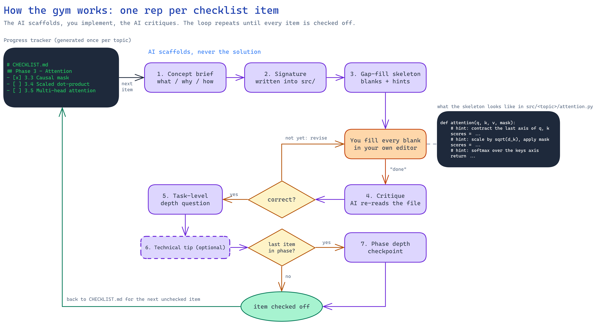
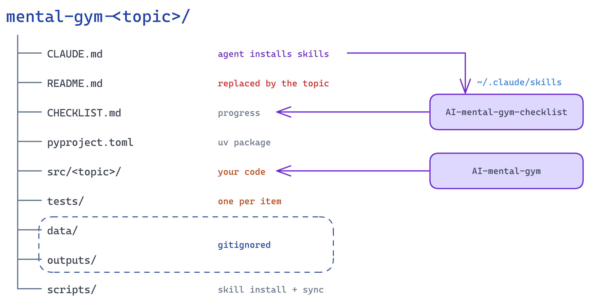

# mental-gym-TOPIC

> **Template placeholder.** This README describes the template, not a gym.
> When the gym session starts, replace it with the actual topic: what is being
> built, the reference implementation, and the topic's own notes. The
> `AI-mental-gym-checklist` skill does this when it generates `CHECKLIST.md`.

A [mental gym](https://github.com/lun-ai/skills) for building TOPIC from scratch.
Reference implementation: TBD.

Progress lives in [`CHECKLIST.md`](CHECKLIST.md). Blog post: TBD.

## Getting started

Open this repo in Claude Code. Nothing to install by hand: `CLAUDE.md` tells
the agent to install the gym skills from
[lun-ai/skills](https://github.com/lun-ai/skills) if they are missing, generate
`CHECKLIST.md` if it is still the stub, and then start coaching. A good first
message:

```text
Set up the gym.
```

Under the hood the agent runs `scripts/install-skills.sh`, which puts
`AI-mental-gym` and `AI-mental-gym-checklist` into `~/.claude/skills`. You can
run it yourself too. To freeze a copy inside this repo for sharing, run
`scripts/sync-skill.sh` afterwards.

## How the gym works

Say which checklist item you are on. The skill coaches one item at a time
without writing the solution for you.



Each checklist item is one rep: the AI scaffolds a skeleton with hints, you
fill the blanks, the AI critiques, then asks a depth question once it is
correct. The last item of a phase also triggers that phase's depth checkpoint.

## Layout



```
CLAUDE.md     agent instructions: install skills, generate checklist, coach
CHECKLIST.md  phases, items and depth checkpoints
src/TOPIC/    the code you write
tests/        unit tests per checklist item
data/         datasets (gitignored)
outputs/      generated artifacts (gitignored)
scripts/      install-skills.sh (global install), sync-skill.sh (vendor copy)
docs/         diagrams (.excalidraw sources and rendered .png)
```

The diagrams are editable at [excalidraw.com](https://excalidraw.com): open the
`.excalidraw` file in `docs/diagrams/`, or regenerate with the
`excalidraw-diagram` skill.

## Python setup

```
uv sync
uv run pytest
```

## Starting a new gym from this template

1. Create the repo from this template as `mental-gym-<topic>`.
2. Rename `src/topic/` to `src/<topic>/` and set `name` and `packages` in `pyproject.toml`.
3. Open the repo in Claude Code and say "Set up the gym". The agent installs
   the skills, generates `CHECKLIST.md`, and rewrites this README for the
   actual topic.
4. Fill in the reference implementation link if the skill could not infer it.
5. Delete this section.
